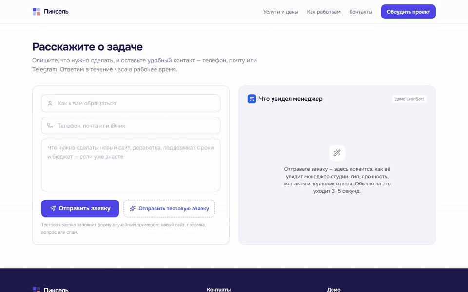
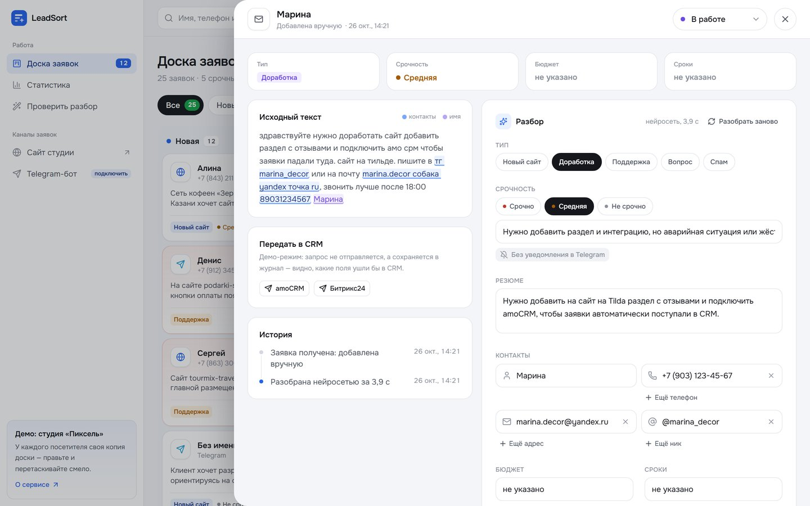
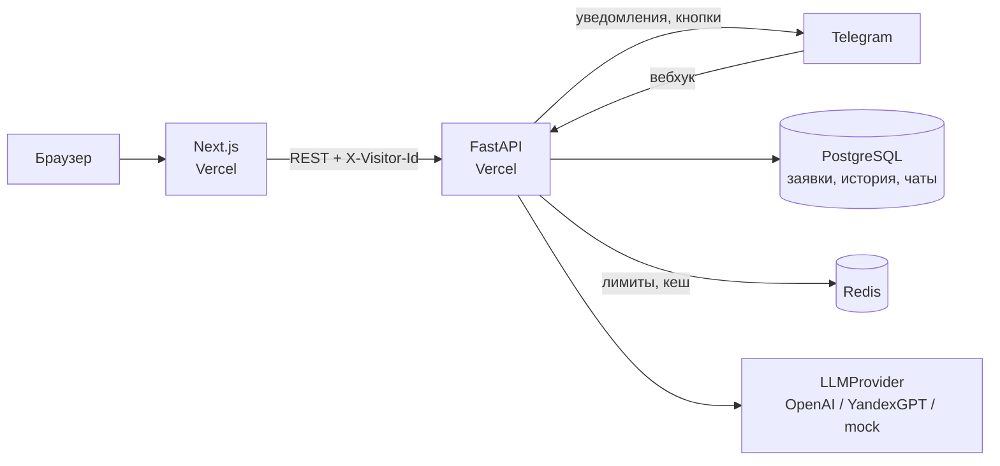

# LeadSort — ИИ-разбор входящих заявок

<p align="center">
  
</p>

Сервис принимает заявки с сайта, из Telegram и почты, а нейросеть раскладывает их по полочкам: тип, срочность, контакты, бюджет и сроки, вопросы клиенту и черновик ответа. Менеджер видит заявки на канбан-доске, о срочных узнаёт в Telegram сразу, о спаме — никогда.

**Для кого:** небольшие компании, где заявки теряются в почте и мессенджерах, а менеджер тратит время на то, чтобы понять, что хочет клиент и как с ним связаться.

**Демо-легенда:** веб-студия «Пиксель», на доске уже 25 заявок разного качества — от подробных брифов до спама и пустых сообщений.

## 🚀 Демо

- Демо: **https://leadsort-ten.vercel.app**
- Telegram-бот: [@pixel_leadsort_bot](https://t.me/pixel_leadsort_bot)
- API: https://leadsort-api.vercel.app/docs
- Регистрация не нужна: при первом входе у вас своя копия демо-доски, которую можно править и сбрасывать.
- `/` — лендинг сервиса, `/pixel` — сайт студии с формой, `/app` — доска, `/app/stats` — статистика, `/try` — песочница разбора.

<p align="center">
  
</p>

## Что умеет

**Сценарий:** клиент пишет на сайт или в Telegram → заявка сразу сохраняется → нейросеть разбирает её за 3–5 секунд → карточка появляется на доске в колонке «Новая» → о срочной менеджер узнаёт в Telegram и одной кнопкой берёт её в работу.

### Каналы приёма

- **Форма на сайте студии** (`/pixel`) — отвечает сразу, разбор идёт в фоне. Рядом панель «Что увидел менеджер» показывает путь заявки с замером времени: получена → разобрана → на доске. Кнопка «Отправить тестовую заявку» заполняет форму случайным примером — новый сайт, поломка, вопрос, спам или «только телефон».
- **Telegram-бот** — сообщение в привязанном чате становится заявкой, бот сразу отвечает разбором. Подробнее ниже.
- **«Добавить заявку»** на доске — вставить текст письма; после добавления сразу открывается карточка, и видно, как нейросеть её разбирает.

### Что нейросеть достаёт из заявки

| Поле | Пример |
| --- | --- |
| Тип | Новый сайт / доработка / поддержка / вопрос / спам |
| Срочность | Высокая / средняя / низкая и причина одной фразой |
| Контакты | Имя, телефоны, почта, Telegram — даже если записаны вперемешку: `8 (916) 123-45-67`, `olga собака gmail точка com`, `t.me/username` |
| Бюджет и сроки | «до 100 тыс. ₽», «к концу месяца» или «не указано» |
| Резюме | 1–2 предложения: что хочет клиент |
| Чего не хватает | Вопросы, без которых не оценить задачу |
| Черновик ответа | Вежливый ответ от студии с уточняющими вопросами — менеджер правит и копирует |

### Доска и карточка заявки

- Колонки «Новая → В работе → Ждём клиента → Закрыта» и свёрнутая колонка «Спам». Карточки перетаскиваются мышью, на телефоне колонки переключаются вкладками.
- Спам уходит в свою колонку сам и никогда не вызывает уведомления; кнопка «Не спам» возвращает заявку на доску.
- Фильтры по типу, срочности и каналу, поиск по тексту, имени и контактам. Плашка ИИ в шапке показывает, сколько срочных ждут ответа, и по клику открывает только их.
- Карточка: исходный текст с подсвеченными контактами рядом с тем, что извлекла нейросеть. Любое поле правится вручную и помечается «изменено»; «Разобрать заново» спрашивает модель ещё раз. У каждой заявки своя история.

<p align="center">
  
</p>

### Статистика, экспорт и CRM

- `/app/stats` — заявки за 7 дней по дням, распределение по типам, каналам и колонкам, доля спама, среднее время разбора нейросетью и доля заявок, поправленных вручную.
- «Экспорт в CSV» — все поля разбора и исходный текст; файл сразу открывается в Excel по колонкам.
- «Передать в CRM» собирает запрос в amoCRM (`/api/v4/leads/complex`) или Битрикс24 (`crm.lead.add`): контакты, теги, бюджет числом, комментарий с резюме и вопросами. В демо запрос не отправляется — он сохраняется в журнал вместе с типичным ответом CRM.

## Telegram-бот

- **Привязка без регистрации.** В меню доски «Telegram-бот» → «Подключить в Telegram»: одноразовая ссылка `t.me/<бот>?start=<токен>` привязывает чат к доске посетителя. Окно на сайте само замечает, что чат подключён.
- **Заявки из чата.** Сообщение в привязанном чате становится заявкой из Telegram: бот отвечает «разбираю…», а через несколько секунд заменяет это сообщение разбором — тип, срочность, суть, контакты, бюджет и сроки. Ник отправителя попадает в контакты, а нейросеть знает, что заявка пришла из мессенджера, и не спрашивает, как связаться.
- **Срочные заявки** с сайта и добавленные вручную приходят в чат с кнопками «Взять в работу» и «Ждём клиента» — они переносят карточку на доске — и «Открыть на доске». «Разобрать заново» уведомление не повторяет.
- Без привязки бот отвечает от лица студии и даёт ссылку на демо-доску; `/stop` отключает чат.
- Бот написан на Bot API поверх `httpx`, без отдельной библиотеки: обновления приходят одинаково из вебхука (Vercel) и из опроса (локально). Вебхук защищён секретным заголовком и ставится сам при первом обращении к `/api/telegram`.

## Как устроен разбор

```
Текст заявки ─► правила: пустое сообщение? только контакт? ─► готово без нейросети
                      │
                      ▼
               LLMProvider ─► JSON по схеме ─► Pydantic
                      │
     контакты сверяются с исходным текстом: выдуманный телефон в карточку не попадёт
                      │
                      ▼
          тип, срочность, контакты, бюджет, сроки, вопросы, черновик ответа
```

- **Слой `LLMProvider`** (`backend/app/llm/`) выбирается переменной `LLM_PROVIDER`:
  - `openai` — любой OpenAI-совместимый API: OpenAI, OpenRouter, DeepSeek, vLLM, Ollama. Ответ запрашивается через `response_format: json_schema` в строгом режиме;
  - `yandex` — YandexGPT: данные не уходят за рубеж;
  - `mock` — разбор по ключевым словам без внешнего API, чтобы проект запускался без ключей.
- Телефоны, почта и ники Telegram ищутся регулярками в любом виде записи. Номера договоров, ИНН и цены телефоном не считаются. Модели нельзя доверять на слово, поэтому контакты из её ответа сверяются с исходным текстом отдельным кодом, а не просьбой в промпте.
- Промпт знает справку о студии — услуги, цены и сроки, — поэтому черновик ответа отвечает на вопросы о ценах по фактам, без выдуманных скидок.
- Заявка сохраняется сразу, а разбор идёт в фоне: форма отвечает мгновенно.

## Демо-заявки и точность

В `backend/app/seed/pixel-leads.json` — 25 заявок студии «Пиксель»: подробные брифы, сообщения капслоком без знаков препинания, контакты вперемешку, письмо на английском, резюме соискателя, взлом сайта с «рекламой казино», SEO-рассылки, бессмыслица и пустая форма. У каждой записан правильный ответ: тип, срочность и контакты.

Скрипт прогоняет их через нейросеть, сверяет результат и сохраняет разборы в `pixel-leads.results.json` — демо-доска берёт их оттуда, поэтому первый визит не тратит токены:

```bash
cd backend
uv run python scripts/evaluate_demo.py --report demo-report.html
```

Последний прогон на gpt-5.6-luna: **тип верно в 25 из 25** заявок (цель — 22), все телефоны, адреса и ники найдены в 25 из 25, срочность совпала в 24 из 25. Заявка с формы оказывается на доске разобранной за 3–7 секунд после отправки.

## Защита бюджета публичного демо

| Мера | Значение по умолчанию |
| --- | --- |
| Размер заявки | до 4000 символов |
| Разборов с одного IP | 30 в час; в Telegram — 30 в час на чат |
| Кеш | одинаковые тексты берутся из Redis 7 дней; «Разобрать заново» идёт мимо кеша |
| Сброс | кнопка «Сбросить демо» возвращает исходные 25 заявок, до 10 раз в час |
| Очистка | доски без визитов дольше суток удаляет ночная задача, демо пересоздаётся при следующем визите |

## Архитектура



- Регистрации нет: фронтенд создаёт анонимный `visitor_id` в `localStorage`, у каждого посетителя своя доска и своя копия демо.
- В Docker разбор идёт фоновой задачей в процессе API, а бот — отдельный сервис, который сам опрашивает Telegram.
- На Vercel нет постоянного процесса, поэтому включается режим `QUEUE_MODE=poll`: заявка ждёт в очереди, а разбирает её следующий опрос — со страницы формы, с доски или из карточки. Заявки захватываются через `SELECT … FOR UPDATE SKIP LOCKED`, брошенные возвращаются в очередь. Заявки из Telegram разбираются прямо в вебхуке.

## Стек

| Часть | Технологии |
| --- | --- |
| Фронтенд | Next.js 16 (App Router, Cache Components), TypeScript, Tailwind CSS 4, SWR, dnd-kit, lucide-react |
| Бэкенд | Python 3.12, FastAPI, SQLAlchemy 2 (async), Pydantic 2, httpx |
| Данные | PostgreSQL 16 (в демо — Neon), Redis (в демо — Upstash) |
| Нейросеть | OpenAI API (gpt-5.6-luna), YandexGPT, шаблонный разбор без ключей |
| Telegram | Bot API: вебхук на Vercel, опрос в Docker |

Приём заявок и маршрутизацию можно собрать и в n8n, оставив FastAPI только для разбора нейросетью: эндпоинт `POST /api/triage` принимает текст и возвращает разбор.

## Запуск локально

Нужен Docker.

```bash
cp .env.example .env
docker compose up --build
```

- Лендинг: http://localhost:3000
- Сайт студии с формой: http://localhost:3000/pixel
- Доска: http://localhost:3000/app
- Песочница разбора: http://localhost:3000/try
- API и Swagger: http://localhost:8000/docs

По умолчанию `LLM_PROVIDER=mock` — всё работает без ключей. Чтобы подключить настоящую модель, укажите в `.env`:

```env
LLM_PROVIDER=openai
OPENAI_API_KEY=sk-...
OPENAI_MODEL=gpt-5.6-luna
OPENAI_REASONING_EFFORT=none
```

**Telegram-бот локально.** Создайте бота у [@BotFather](https://t.me/BotFather) и добавьте токен в `.env` строкой `TELEGRAM_BOT_TOKEN=...` — сервис `bot` в Docker начнёт опрашивать Telegram. Telegram отдаёт сообщения либо вебхуку, либо опросу, поэтому для локальной проверки удобнее отдельный бот, а не тот, что работает на проде. Кнопка «Открыть на доске» появляется только на https-адресе.

## Деплой на Vercel

Фронтенд и бэкенд — два проекта Vercel из одного репозитория (Root Directory `frontend` и `backend`). База — Postgres (Neon), кеш и лимиты — Redis (Upstash): обе подключаются через вкладку Storage, переменные подставляются сами. Ночная очистка — Vercel Cron, раз в сутки вызывает `/api/cron/cleanup` с `CRON_SECRET`.

| Проект | Переменная | Значение |
| --- | --- | --- |
| backend | `LLM_PROVIDER` | `openai` |
| backend | `OPENAI_API_KEY` | ключ OpenAI |
| backend | `OPENAI_MODEL` | `gpt-5.6-luna` |
| backend | `OPENAI_REASONING_EFFORT` | `none` |
| backend | `CORS_ORIGINS` | адрес фронтенда, `https://….vercel.app` |
| backend | `CORS_ORIGIN_REGEX` | превью-деплои, например `^https://leadsort-.*\.vercel\.app$` |
| backend | `CRON_SECRET` | случайная строка |
| backend | `TELEGRAM_BOT_TOKEN` | токен бота от @BotFather; вебхук поставится сам |
| backend | `DATABASE_URL…`, `REDIS_URL` / `KV_URL` | подставляют Neon и Upstash |
| frontend | `NEXT_PUBLIC_API_URL` | адрес бэкенда, `https://….vercel.app` |

---

Демо-проект: студия «Пиксель», клиенты и контакты в примерах вымышлены.
